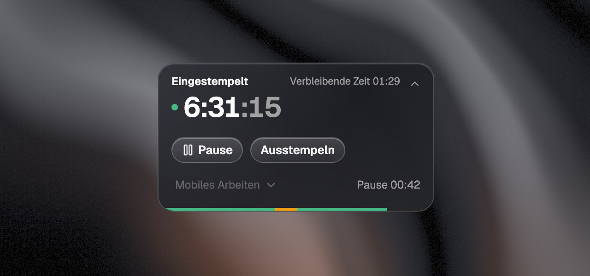
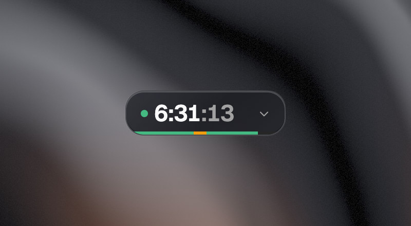
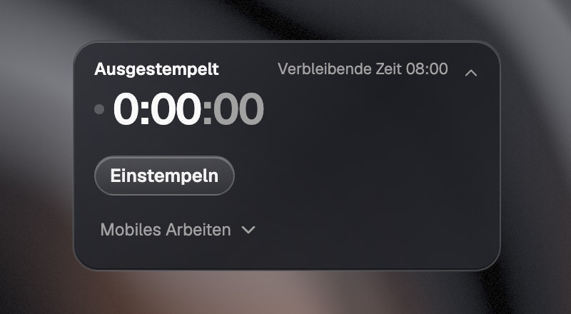
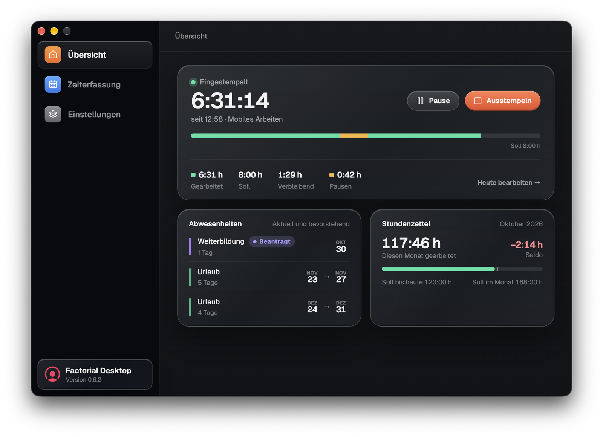
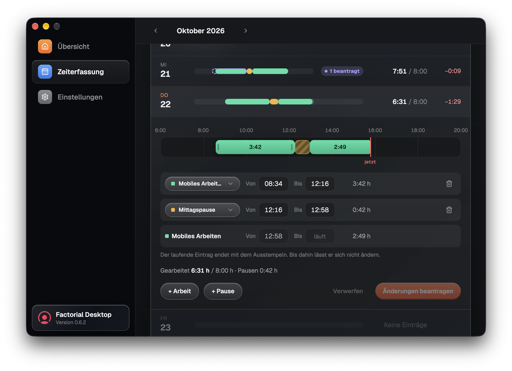
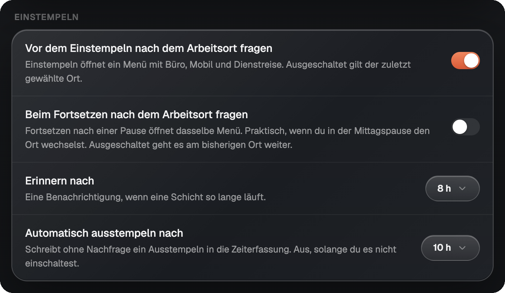

<p align="center">
  
</p>

<h1 align="center">Factorial Desktop</h1>

<p align="center">
  <strong>Zeiterfassung in Factorial HR, ohne den Browser zu öffnen.</strong><br>
  Ein kleiner Timer schwebt auf deinem Bildschirm. Von dort stempelst du ein, machst Pause und stempelst aus.
</p>

<p align="center">
  <a href="https://github.com/MaxLikesCode/factorial-desktop/releases/latest"></a>
</p>

<p align="center">
  
  
  
</p>

<p align="center">
  <a href="README.md">English</a> · <strong>Deutsch</strong>
</p>

<p align="center">
  
</p>

## Was es macht

Wenn deine Firma die Arbeitszeit in Factorial erfasst, suchst du vor jedem Einstempeln erst den richtigen Browser-Tab. Factorial Desktop legt dir stattdessen eine kleine Karte in die Ecke deines Bildschirms. Sie zeigt, wie lange du heute schon arbeitest, und ein Klick öffnet **Pause** und **Ausstempeln**.

Hinter der Karte steckt ein ganzes Fenster mit deinem Tag, deinem Monat und der Zeiterfassung, in der du ein vergessenes Einstempeln korrigierst und die Änderung zur Genehmigung schickst. Alles landet direkt in deiner echten Zeiterfassung in Factorial, deine Führungskraft sieht also dieselben Zahlen wie du.

> [!NOTE]
> Factorial Desktop ist eine unabhängige App und stammt nicht von Factorial. Du meldest dich mit deinem normalen Factorial-Konto an.

## Auf einen Blick

- **Immer im Blick.** Die Karte bleibt über deinen anderen Fenstern, auf dem Mac sogar über Apps im Vollbild.
- **Ein Klick genügt.** Karte aufklappen, und **Pause**, **Ausstempeln** und der Arbeitsort sind da.
- **Deine echte Zeiterfassung.** Jeder Klick geht sofort an Factorial. Bricht die Verbindung ab, zeigt die Karte den letzten bekannten Stand und sagt das auch.
- **Tage selbst korrigieren.** Zieh einen Block in der Zeiterfassung zurecht, und die App schickt Factorial einen Änderungsantrag, wie ihn auch die Web-App stellt.
- **Erinnerungen für saubere Einträge.** Ein Hinweis nach 8 Stunden, eine Erinnerung an die Mittagspause und auf Wunsch automatisches Ausstempeln.
- **Spricht deine Sprache.** Deutsch, English, Español, Français, Italiano, Português und Nederlands.

## In drei Schritten startklar

1. **Installier die App** aus der [neuesten Version](https://github.com/MaxLikesCode/factorial-desktop/releases/latest). Welche Datei die richtige ist, steht unter [Installation](#factorial-desktop-installieren).
2. **Melde dich bei Factorial an.** Beim ersten Start öffnet sich die Anmeldeseite von Factorial in einem Fenster. Die Zwei-Faktor-Anmeldung funktioniert wie im Browser.
3. **Stempel ein.** Klick auf den Pfeil der Karte, dann auf **Einstempeln**, und wähl, wo du heute arbeitest: **Büro**, **Mobiles Arbeiten** oder **Dienstreise**.

Die App merkt sich deine Anmeldung und öffnet ab jetzt direkt die Karte.

## Was drin ist

### Ein Timer, der nicht im Weg ist

Die meiste Zeit ist die Karte zugeklappt: ein Punkt, die heutige Arbeitszeit und ein schmaler Balken. Grün ist Arbeit, Orange ist Pause. Klick auf den Pfeil oder doppelklick die Karte, um sie aufzuklappen, und zieh sie dorthin, wo sie am besten passt.

<table>
  <tr>
    <td width="50%"></td>
    <td width="50%"></td>
  </tr>
  <tr>
    <td>Zugeklappt nur die Zeit und die Form deines Tages.</td>
    <td>Aufgeklappt die Knöpfe. <b>Einstempeln</b> fragt zuerst, wo du arbeitest.</td>
  </tr>
</table>

Die aufgeklappte Karte zeigt, wie viel bis zu deinem Tagessoll fehlt, und **Soll erfüllt · +0:43**, sobald du drüber bist. In der Pause wird die große Zahl zur Uhr der Pause. Stören dich die tickenden Sekunden, schalte **Sekunden anzeigen** aus, dann wird die Karte etwas schmaler.

### Tag und Monat auf einen Blick

Das App-Fenster öffnest du über das Menü in der Menüleiste oder im Infobereich. Die **Übersicht** zeigt die heutige Schicht mit allen vier Zahlen (gearbeitet, Soll, verbleibend, Pausen), deine nächsten Abwesenheiten, wie sie auch auf deiner Profilseite in Factorial stehen, und wie der Monat bisher gegenüber dem Soll steht.

<p align="center">
  
</p>

### Ein vergessenes Einstempeln korrigieren

Die **Zeiterfassung** zeigt den Monat mit einer Zeile pro Tag, jeweils als Streifen von morgens bis abends, daneben die gearbeiteten Stunden und der Saldo. Der heutige Tag ist beim Öffnen schon aufgeklappt.

<p align="center">
  
</p>

- **Zieh an den Kanten** eines Blocks im Streifen, oder tipp die Zeiten ein. Blöcke rasten in Fünf-Minuten-Schritten ein.
- **Arbeit oder Pause hinzufügen** mit **+ Arbeit** und **+ Pause**, oder einen Block mit dem Papierkorb löschen.
- **Änderungen beantragen** schickt sie zur Genehmigung an Factorial. Deine Zeiterfassung ändert sich erst nach der Genehmigung. Bis dahin steht beim Tag **1 beantragt**, und du kannst den Antrag zurückziehen.

Manchmal würde Factorial eine Änderung heute ablehnen, weil sie mit einem Block kollidiert, der selbst noch auf Genehmigung wartet. Die App behält so eine Änderung auf deinem Rechner und schickt sie, sobald der Weg frei ist.

### Erinnerungen, damit die Einträge stimmen



Alles stellst du in den **Einstellungen** im App-Fenster ein.

- **Vor dem Einstempeln nach dem Arbeitsort fragen.** Standardmäßig an, denn ein gemerktes „Büro“ an einem Tag zu Hause ist ein falscher Eintrag, der niemandem auffällt.
- **Beim Fortsetzen nach dem Arbeitsort fragen,** falls du in der Mittagspause den Ort wechselst.
- **Erinnern nach**, wenn eine Schicht 8 Stunden läuft.
- **Automatisch ausstempeln nach** einer gewählten Zahl von Stunden. Aus, solange du es nicht einschaltest.
- **Pausenerinnerungen** nach einer gewissen Pausenlänge, und eine Erinnerung an die Mittagspause zu einer festen Uhrzeit oder nach einigen Arbeitsstunden, aber nur, wenn du heute noch keine Pause gemacht hast.

<br clear="right">

### Zu Hause in der Menüleiste und im Infobereich

Die Karte hat kein eigenes Dock-Symbol und keinen Knopf in der Taskleiste. Schließen blendet sie nur aus, und das Symbol in der Menüleiste oder im Infobereich holt sie zurück.

Auf dem Mac steht die laufende Zeit direkt neben dem Symbol in der Menüleiste, zum Beispiel `6:31` oder `Pause 0:09`. Unter Windows zeigt die Farbe des Symbols den Zustand, und beim Darüberfahren erscheint die Zeit:

| Symbol | Zustand |
|---|---|
|  | Ausgestempelt |
|  | Eingestempelt |
|  | In einer Pause |
|  | Nicht angemeldet |

Das Menü kann alles, was die Karte kann, dazu die Pausenarten, **Zeiterfassung …**, **Einstellungen** und **Aktualisieren**.

> [!TIP]
> Unter Windows verstecken sich neue Symbole hinter dem Pfeil `^` im Infobereich. Zieh das Symbol einmal auf die Taskleiste, dann bleibt es dort.

### Die kleinen Dinge

- **Zwei Looks für die Karte.** **Glass** wie auf den Bildern, oder **Simple**.
- **Klappt in beide Richtungen auf.** Standardmäßig wächst die Karte nach links, damit sie am rechten Bildschirmrand Platz hat. Liegt sie bei dir links, stell **Aufklappen** auf **Nach rechts**.
- **Hell und Dunkel** folgen deinem System, oder du legst es in den **Einstellungen** fest.
- **Autostart**, wenn die Karte jeden Morgen schon da sein soll.
- **Updates** sucht die App eine halbe Minute nach dem Start und dann alle sechs Stunden. Sie fragt, bevor sie etwas herunterlädt, außer du hast automatische Updates angehakt. Ein Neustart für ein Update beendet deine Schicht nicht, denn die liegt in Factorial.

## Deine Anmeldung und deine Daten

- **Dein Passwort** gibst du auf der Anmeldeseite von Factorial ein, die App bekommt es nie zu sehen. Die Anmeldung bleibt auf deinem Rechner gespeichert, du musst dich also nicht jeden Tag neu anmelden.
- **Keine eigenen Server.** Die App spricht mit Factorial und, für Updates, mit GitHub. Es gibt keine Analyse-Tools.
- **Kein Raten.** Erreicht die App Factorial nicht, zeigt sie die letzte bekannte Zeit und kennzeichnet sie als veraltet, statt sich etwas Plausibles auszudenken.

**Nicht enthalten:** Abwesenheiten beantragen (sie werden nur angezeigt) und eine Version für Macs mit Intel-Prozessor.

## Factorial Desktop installieren

Lad die passende Datei aus der [neuesten Version](https://github.com/MaxLikesCode/factorial-desktop/releases/latest) herunter:

| Rechner | Datei | |
|---|---|---|
| **Mac** mit Apple silicon | `Factorial-Desktop-<version>-arm64.dmg` | Öffnen und die App in „Programme“ ziehen. |
| **Windows** | `Factorial-Desktop-Setup-<version>.exe` | Installiert nur für deinen Benutzer, ohne Adminrechte. Die richtige Wahl für die meisten. |
| **Windows**, ohne Installation | `Factorial-Desktop.exe` | Läuft von überall, zum Beispiel vom USB-Stick. Kann sich nicht selbst aktualisieren und verweist stattdessen auf die Download-Seite. |

> [!IMPORTANT]
> Die Windows-Version ist nicht signiert, deshalb zeigt SmartScreen beim ersten Start einen blauen Hinweis. Klick auf **Weitere Informationen** und dann auf **Trotzdem ausführen**. Die Mac-Version ist signiert und notarisiert und startet ganz normal.

### Voraussetzungen

- macOS 12 oder neuer auf einem Mac mit Apple silicon, oder Windows 10 oder neuer (64 Bit)
- Ein Factorial-HR-Konto mit Zeiterfassung

## Aus dem Quellcode bauen

Du brauchst Node 22 oder neuer.

```bash
git clone https://github.com/MaxLikesCode/factorial-desktop.git
cd factorial-desktop
npm install
npm run dev
```

| Befehl | Was er macht |
|---|---|
| `npm run dev` | Startet die App mit Hot Reload |
| `npm test` | Führt die Unit-Tests aus (ohne Electron) |
| `npm run typecheck` | Prüft die Typen in Main, Preload, Shared und Renderer |
| `npm run build` | Prüft die Typen und baut nach `out/` |
| `npm run package:mac` | Baut DMG und ZIP für Apple silicon |
| `npm run package:win` | Baut den Installer und die portable `.exe` für x64 |
| `npm run dev:update` | Zeigt das Update-Fenster mit Beispieldaten |

Die fertigen Pakete landen in `release/`.

**Eine Sprache hinzufügen.** Kopier `src/shared/locales/de.ts`, übersetz die Texte und trag den Code in `LOCALES` in `src/shared/i18n.ts` und in `CATALOGUES` in `src/shared/locales/index.ts` ein. TypeScript meldet jeden vergessenen Schlüssel, und die Tests prüfen, dass Platzhalter wie `{time}` zu den englischen passen.

**Eine Version veröffentlichen.** Ein `v*`-Tag baut beide Plattformen und hängt die Dateien an ein GitHub-Release:

```bash
npm version patch
git push origin main --follow-tags
```

## Mehr Details

Diese Dokumente gibt es nur auf Englisch:

- [Design](docs/DESIGN.md): wie die App aufgebaut ist und welche Factorial-API sie nutzt
- [API discovery](docs/api-discovery.md): wie die API erschlossen wurde und wie man eine Abfrage findet, die noch niemand gebraucht hat
- [Releasing](docs/RELEASING.md): eine Version veröffentlichen, die Versionsnummer wählen und warum die Signatur unter macOS wichtig ist
