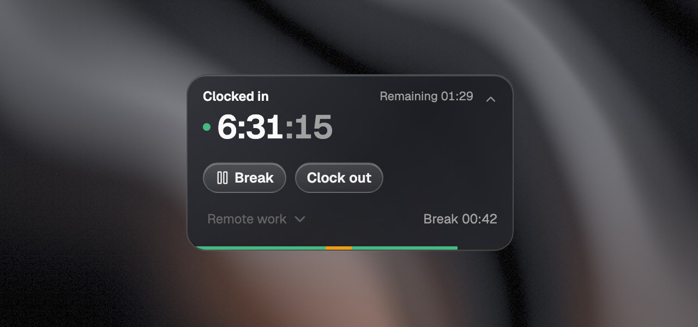
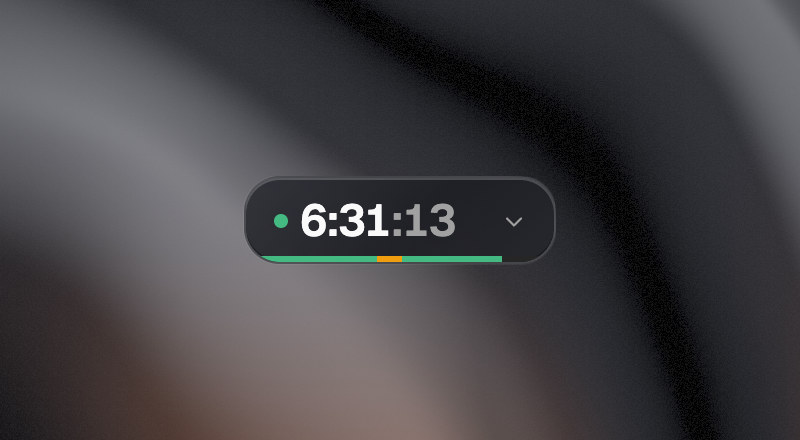
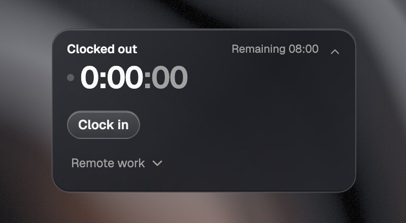
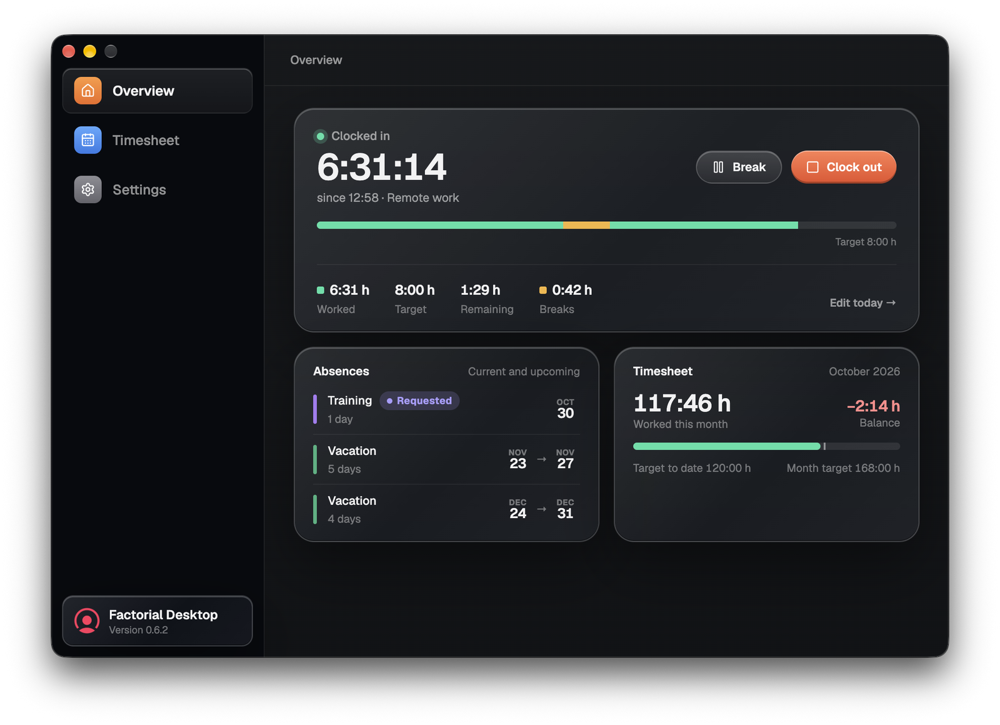
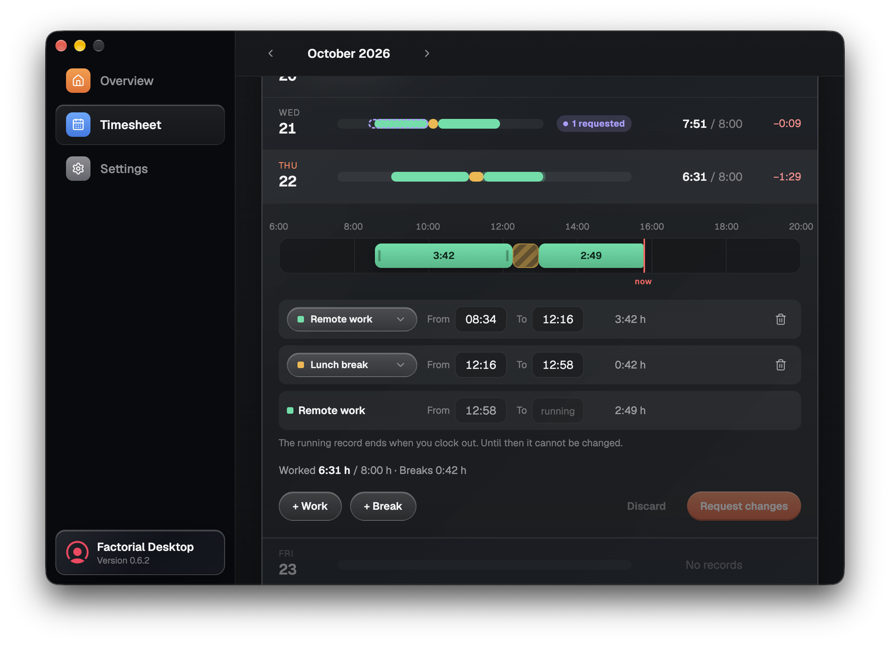
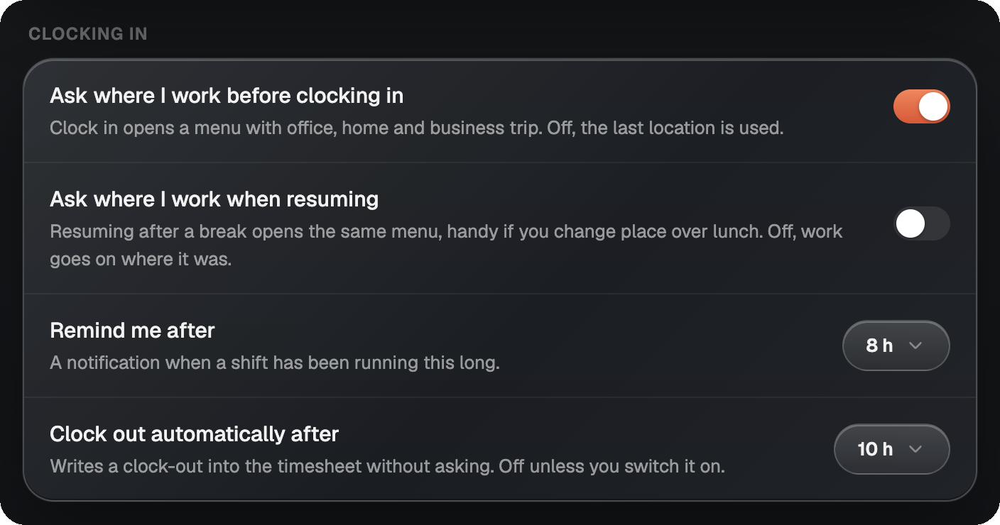

<p align="center">
  
</p>

<h1 align="center">Factorial Desktop</h1>

<p align="center">
  <strong>Track your time in Factorial HR without opening the browser.</strong><br>
  A small timer floats on your desktop. Clock in, take a break and clock out from there.
</p>

<p align="center">
  <a href="https://github.com/MaxLikesCode/factorial-desktop/releases/latest"></a>
</p>

<p align="center">
  
  
  
</p>

<p align="center">
  <strong>English</strong> · <a href="README.de.md">Deutsch</a>
</p>

<p align="center">
  
</p>

## What it does

If your company tracks working hours in Factorial, every clock-in means finding the right browser tab first. Factorial Desktop puts a small card in the corner of your screen instead. It shows how long you've worked today, and one click opens **Break** and **Clock out**.

Behind the card there's a full window with your day, your month and the timesheet, where you can fix a forgotten clock-in and send the change for approval. Everything goes straight into your real Factorial timesheet, so your manager sees the same numbers you do.

> [!NOTE]
> Factorial Desktop is an independent app and isn't made by Factorial. You sign in with your normal Factorial account.

## Highlights

- **Always in view.** The card stays above your other windows, on macOS even over full-screen apps.
- **One click to act.** Open the card and **Break**, **Clock out** and the work location are right there.
- **Your real timesheet.** Every click is written to Factorial at once. When the connection drops, the card shows the last known state and says so.
- **Fix a day yourself.** Drag a block in the timesheet and the app sends Factorial a change request, the same kind the web app sends.
- **Reminders that keep records clean.** A nudge after 8 hours, a lunch reminder, and an automatic clock-out if you want one.
- **Speaks your language.** English, Deutsch, Español, Français, Italiano, Português and Nederlands.

## Start in three steps

1. **Install the app** from the [latest release](https://github.com/MaxLikesCode/factorial-desktop/releases/latest). The [install section](#get-factorial-desktop) says which file to pick.
2. **Sign in to Factorial.** The first launch opens Factorial's own login page in a window. Two-factor sign-in works the same as in the browser.
3. **Clock in.** Click the arrow on the card, press **Clock in** and choose where you work today: **Office**, **Remote work** or **Business trip**.

The app remembers your sign-in, so from now on it opens straight to the card.

## What's inside

### A timer that stays out of the way

Most of the day the card is closed: a dot, today's working time and a thin bar. Green is work, amber is a break. Click the arrow or double-click the card to open it, and drag it wherever it fits best.

<table>
  <tr>
    <td width="50%"></td>
    <td width="50%"></td>
  </tr>
  <tr>
    <td>Closed, it's just the time and the shape of your day.</td>
    <td>Open, it has the buttons. <b>Clock in</b> asks where you work first.</td>
  </tr>
</table>

The open card shows how much is left until your daily target, and **Target met · +0:43** once you're past it. During a break the big number turns into the break's own clock. If the ticking seconds bother you, switch off **Show seconds** and the card gets a little narrower.

### Your day and month at a glance

The app window opens from the tray menu. **Overview** has today's shift with all four numbers (worked, target, remaining, breaks), your upcoming absences as Factorial's profile page lists them, and how the month stands against your target so far.

<p align="center">
  
</p>

### Fix a forgotten clock-in

**Timesheet** shows the month one day per row, each as a strip from morning to evening, with the hours worked and the balance next to it. Today's day is open when you arrive.

<p align="center">
  
</p>

- **Drag the edges** of a block on the strip, or type the times. Blocks snap to five minutes.
- **Add work or a break** with **+ Work** and **+ Break**, or delete a block with the bin.
- **Request changes** sends them to Factorial for approval. Your timesheet only changes once they're approved, and until then the day shows **1 requested** and you can withdraw the request.

Sometimes Factorial would refuse a change today because it collides with a block that's still waiting for approval. The app keeps that change on your computer and sends it once the way is clear.

### Reminders that keep the record straight



Everything is set up in **Settings** in the app window.

- **Ask where I work before clocking in.** On by default, because a remembered "Office" on a day at home is a wrong record nobody notices.
- **Ask where I work when resuming,** for when you change places over lunch.
- **Remind me after** a shift has run 8 hours.
- **Clock out automatically after** a number of hours. Off unless you switch it on.
- **Break reminders** after a break has run a while, and a lunch reminder at a set time or after a number of hours, but only if you haven't taken a break yet.

<br clear="right">

### Lives in the menu bar or the tray

The card has no Dock icon or taskbar button of its own. Closing it only hides it, and the menu bar or tray icon brings it back.

On macOS the running time sits right next to the icon in the menu bar, for example `6:31` or `Break 0:09`. On Windows the icon's color tells you the state, and hovering shows the time:

| Icon | State |
|---|---|
|  | Clocked out |
|  | Clocked in |
|  | On a break |
|  | Signed out |

The menu has everything the card has, plus the break types, **Timesheet**, **Settings** and **Refresh**.

> [!TIP]
> On Windows, new tray icons are hidden behind the `^` arrow. Drag the icon onto the taskbar once and it stays there.

### The small things

- **Two looks for the card.** **Glass**, as in the screenshots, or **Simple**.
- **Opens either way.** The card grows to the left by default, so it fits at the right edge of the screen. Switch it to the right if you keep it on the left.
- **Light and dark** follow your system, or pick one in **Settings**.
- **Start at login** if you want the card there every morning.
- **Updates** are checked half a minute after launch and every six hours. The app asks before downloading anything, unless you tick the box to install updates automatically. Restarting for an update doesn't end your shift, since it lives in Factorial.

## Your sign-in and your data

- **Your password** goes into Factorial's own login page and is never seen by the app. The sign-in is kept on your computer, so you don't have to log in every day.
- **No servers of its own.** The app talks to Factorial and, for updates, to GitHub. There are no analytics.
- **No guessing.** If the app can't reach Factorial, it shows the last time it knows and marks it as out of date rather than inventing something plausible.

**Not included:** requesting time off (absences are shown, not requested) and a build for Intel Macs.

## Get Factorial Desktop

Download the file for your computer from the [latest release](https://github.com/MaxLikesCode/factorial-desktop/releases/latest):

| Computer | File | |
|---|---|---|
| **Mac** with Apple silicon | `Factorial-Desktop-<version>-arm64.dmg` | Open it and drag the app to Applications. |
| **Windows** | `Factorial-Desktop-Setup-<version>.exe` | Installs for your user only, no admin rights needed. The one to pick. |
| **Windows**, without installing | `Factorial-Desktop.exe` | Runs from anywhere, for example a USB stick. Can't update itself, so it points you to the download page instead. |

> [!IMPORTANT]
> The Windows build isn't signed, so SmartScreen shows a blue box on the first launch. Click **More info**, then **Run anyway**. The Mac build is signed and notarized and opens normally.

### Requirements

- macOS 12 or later on a Mac with Apple silicon, or Windows 10 or later (64-bit)
- A Factorial HR account with time tracking

## Building from source

You need Node 22 or later.

```bash
git clone https://github.com/MaxLikesCode/factorial-desktop.git
cd factorial-desktop
npm install
npm run dev
```

| Command | What it does |
|---|---|
| `npm run dev` | Starts the app with hot reload |
| `npm test` | Runs the unit tests (no Electron needed) |
| `npm run typecheck` | Checks types across main, preload, shared and renderer |
| `npm run build` | Typechecks, then builds to `out/` |
| `npm run package:mac` | Builds the DMG and ZIP for Apple silicon |
| `npm run package:win` | Builds the installer and the portable `.exe` for x64 |
| `npm run dev:update` | Shows the update window with sample data |

The packages end up in `release/`.

**Adding a language.** Copy `src/shared/locales/de.ts`, translate the values, then add the code to `LOCALES` in `src/shared/i18n.ts` and to `CATALOGUES` in `src/shared/locales/index.ts`. TypeScript names any key you missed, and the tests check that placeholders such as `{time}` match the English ones.

**Releasing.** A `v*` tag builds both platforms and attaches the files to a GitHub release:

```bash
npm version patch
git push origin main --follow-tags
```

## Want the details?

- [Design](docs/DESIGN.md): how the app is put together, and the Factorial API it uses
- [API discovery](docs/api-discovery.md): how the API was mapped out, and how to find a query nobody has needed yet
- [Releasing](docs/RELEASING.md): cutting a release, picking the version number, and why macOS signing matters
